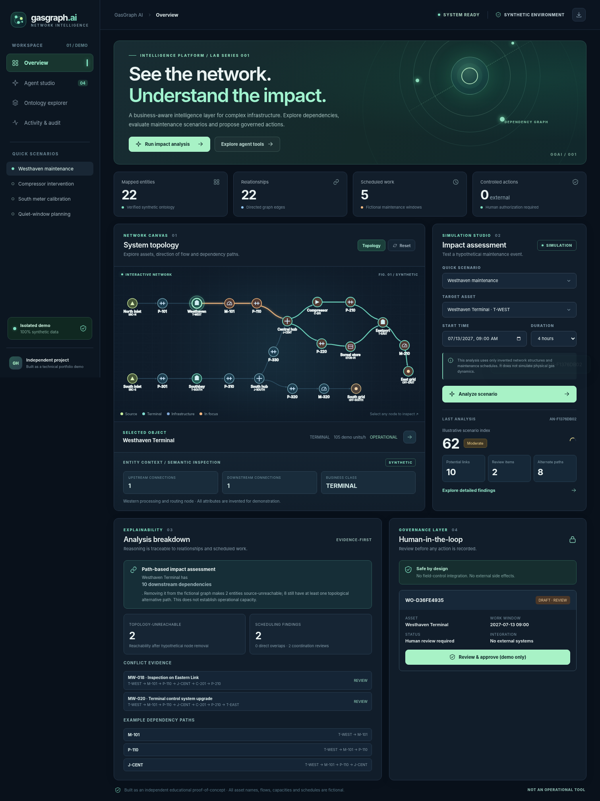

<div align="center">

# GasGraph AI

**A transparent network-intelligence prototype for synthetic infrastructure**

*Explore asset relationships, trace dependencies, review maintenance conflicts, and inspect explainable tool-assisted analyses.*

**[Open the interactive application](https://gakkomimem.github.io/gasgraph-ai/)**

</div>



## Overview

GasGraph AI is an independent technical portfolio project exploring how structured information about assets and relationships can support infrastructure analysis. The interactive application models a **fully fictional** gas-transport network and demonstrates explainable graph and scheduling calculations.

No real infrastructure data is used. The project is not affiliated with or endorsed by Gassco. It does not connect to operational systems and must not be used for safety-critical decisions. Graph reachability is not a hydraulic or flow-capacity simulation.

## Interactive application

[**Launch GasGraph AI**](https://gakkomimem.github.io/gasgraph-ai/)

The browser application offers:

- **Network overview:** inspect fictional assets and directed connections.
- **Dependency analysis:** trace downstream relationships and view evidence paths.
- **Maintenance planning:** compare time windows, identify direct scheduling conflicts, and flag related work for coordination review.
- **Alternative-route analysis:** check topological reachability after a hypothetical asset removal (not physical flow feasibility).
- **Agent Studio:** inspect deterministic, rule-based tool routing and its returned evidence. The browser version does not use a generative language model.
- **Ontology explorer:** examine entity categories, IDs, properties, and relationships.

Analyses run locally as JavaScript in the visitor's browser. No login or installation is required. Any displayed work orders are unsubmitted fictional drafts; public approval is disabled.

## Architecture

The repository contains two complementary implementations:

| Component | Role |
| --- | --- |
| `docs/` | Standalone browser application served via GitHub Pages |
| `docs/static-engine.js` | Browser-side graph and maintenance analysis |
| `data/` | Fictional network, schedules, and scenario fixtures |
| `gasgraph/` | Python reference engine, local HTTP server, optional integrations |
| `web/` | Local Python-server user interface |
| `tests/` | Python regression tests |
| `scripts/test_static_pages.cjs` | Browser-engine parity and consistency checks |

The default browser experience is deterministic. Optional local LLM and MCP adapters are included in the Python reference project but are not part of the public application and should not be represented as production integrations.

See [Architecture and design decisions](docs/ARCHITECTURE.md) for analysis logic, assumptions, and limitations.

## Run locally

Python 3.11 or newer is required for the reference server:

```bash
python3 -m gasgraph.server
```

Open `http://127.0.0.1:8765`.

To serve the same static application that appears on GitHub Pages:

```bash
python3 -m http.server 8767 --directory docs
```

Open `http://127.0.0.1:8767`.

## Tests

```bash
python3 -m pip install pytest
python3 -m pytest -q
node scripts/test_static_pages.cjs
```

The Python and JavaScript implementations are checked against the included synthetic scenarios. The optional local model and MCP integrations require separate environment-specific testing.

## Technical limitations

- All assets, capacities, maintenance windows, and connections are invented.
- `FLOWS_TO` represents directed *topological* relationships, not measured physical flow.
- No physics, hydraulics, real-world operational safety, identity-based approvals, or production integrations are implemented.
- Agent Studio in the hosted application uses deterministic tool selection, not hosted generative AI.
- Activity is session-scoped rather than a durable multi-user audit system.

## License

MIT. See [LICENSE](LICENSE).
