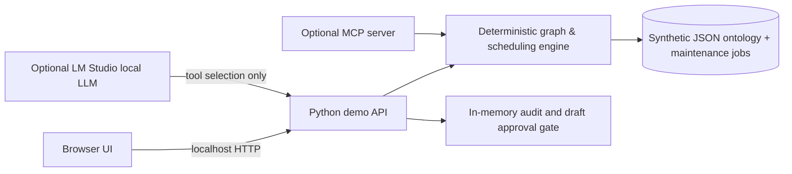

# Architecture & technical decisions

## Architecture at a glance

### Business ontology

- **Entity types:** Source, Pipeline, Terminal, Junction, Compressor, Meter, Storage, Offtake.
- **Relationship:** `FLOWS_TO` defines potential directed topological dependency; it does not assert measured flow.
- **Properties:** ID, name, type, UI coordinate, status, capacity (invented demonstration units), description and data classification.
- **Provenance:** All records originate from `data/*.json` generated by `scripts/generate_demo_data.py`.

### Analysis procedure

1. Validate an existing entity ID, ISO-local request window and bounded duration.
2. Perform breadth-first traversal over `FLOWS_TO`, retaining an exact shortest path for each reached downstream entity.
3. Compute source-reachability in the original graph and under hypothetical removal of the target asset. Classify as **topologically newly unreachable** only if originally source reachable and not reachable after removal.
4. Check maintenance overlap with the half-open interval rule: `start < existing_end and existing_start < end`. Label same-asset overlaps **direct**, overlapping work on a connected upstream/downstream dependency **coordination review**.
5. Provide a transparent, *illustrative* index to help users compare demo scenarios. The index is **not** calibrated risk and has no operational meaning.
6. Create a deterministic work-order ID, an **unsubmitted** draft, and an audit trace. Any approval is a mock in-memory user action.

### Optional local LLM planner

- It uses an OpenAI-compatible chat-completions API on loopback HTTP only.
- An allowlisted single tool, `analyze_maintenance`, takes typed parameters.
- IDs must be from the synthetic inventory; invalid model output is not executed.
- The graph engine, not the LLM, computes results. Responses are assembled from those results.
- The fallback remains deterministic and does not pretend to understand unsupported entity queries.

### MCP adapter

`gasgraph/mcp_server.py` uses the official SDK v2 `MCPServer` API to expose ontology inspection and planning tools via the standard protocol. It does **not** connect to an operational MCP endpoint and cannot execute external actions. No Azure or Fabric credentials are needed.

### Potential Fabric mapping (design proposal, not implemented)

| Current demo | Potential organizational implementation |
| --- | --- |
| `network.json` fictional entities | Governed Fabric / OneLake data tables |
| `FLOWS_TO` topology and Python BFS | Fabric IQ ontology / graph-backed queries |
| Python tool registry | Organization-approved MCP endpoints with permissions |
| Local LLM tool selection | Foundry agent orchestration and tracing |
| Session-only audit log | Identity-bound durable audit logging |
| Mock approval | Authenticated, authorization-checked work order integration |

Microsoft documentation describes ontology-backed entity types, relationships and MCP access. Availability and nomenclature can change because some capabilities remain preview. Do not claim that this application uses Microsoft Fabric or Microsoft Foundry.

- [Microsoft Fabric IQ Ontology](https://learn.microsoft.com/en-us/fabric/iq/ontology/concepts-agent-integration)
- [Microsoft Fabric Ontology MCP](https://learn.microsoft.com/en-us/fabric/iq/ontology/how-to-use-ontology-mcp-server)
- [MCP Python SDK v2](https://py.sdk.modelcontextprotocol.io/)

### Explicit limits

This is not a computational fluid-dynamics or pipeline-operations model. It does not incorporate pressure, linepack, regulatory constraints, actual equipment, safety interlocks, scheduling permissions, measured data or network security classifications. The invented capacity attribute is descriptive only and never used to calculate hydraulic feasibility. A graph alternative route is not proof of feasible throughput.

The local server is designed for single-user demonstration. It has no authentication or production hardening. Keep it on localhost and do not expose it as an internet service.
